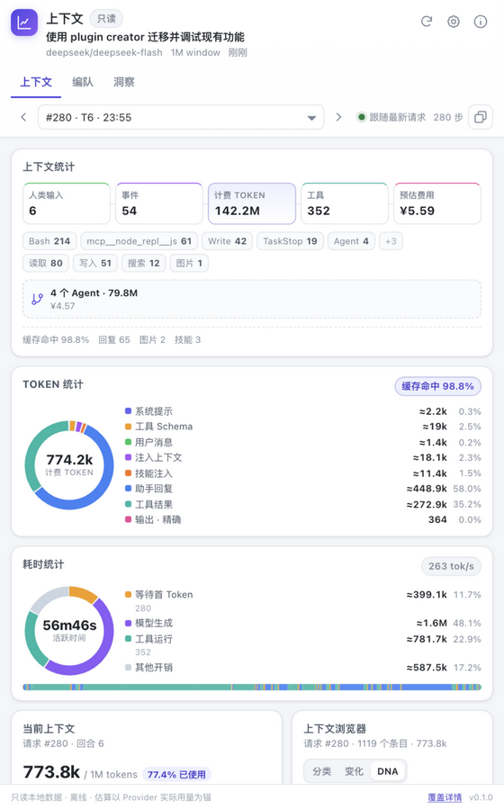

# zcode-context

一个为 [ZCode](https://github.com/zai-org/ZCode) 提供的只读、离线上下文洞察面板，功能移植自
[dsh-context](https://github.com/bowenliang123/dsh-context)（DeepSeek Harness）。

在任意会话右侧面板中打开它，看清模型实际携带了什么：

- **上下文**：当前组成、逐请求趋势、完整请求浏览器、注入与压缩事件、文件活动。
- **编队**：当前 Agent、父级与每个子 Agent，含计费 Token、预估费用与上下文占用。
- **洞察**：跨会话用量、7 日图、8 周热力图、Token 构成、聚合组成与可搜索的会话卡片。

它不会修改会话、不会调用模型，也不会访问网络。



## 它回答什么

| 问题 | 位置 |
| --- | --- |
| 窗口现在有多满？里面是什么？ | **当前上下文** 的堆叠条与图例 |
| 哪一类内容最占空间？ | 系统提示、工具 Schema、用户消息、注入上下文、技能、助手回复、工具结果 |
| 上下文是怎么长起来的？ | **上下文趋势**：每个请求一条堆叠柱；步骤/回合、总量/变化、总览、耗时曲线 |
| 第 N 个请求到底带了什么？ | **上下文浏览器**：分类、搜索、排序、DNA 顺序、元素完整内容 |
| 请求之间发生了什么变化？ | 与上一步/上一回合对比：新增、移除、Token 差值 |
| 运行时注入了什么？ | **上下文事件**：提醒、Agent 列表、后台任务通知、技能加载、压缩摘要 |
| 压缩删掉了什么？ | 压缩事件 → **被摘要的内容**（当前活动分支） |
| Agent 对文件做了什么？ | **文件活动**：读取/写入/搜索/图片、行数差值、逐操作日志 |
| Agent 家族状态如何？ | **编队**：血缘卡片、运行状态、上下文占用、费用 |
| 跨会话用了多少？ | **洞察**：KPI、每日图、热力图、Token 构成、聚合组成、会话卡片 |
| 在对话里快速查看 | `/context` |

## 安装

### 本地开发目录

```sh
npm install
npm run build
npm run package
```

`npm run package` 会把可安装插件写到 `plugins/zcode-context/`，并在 `plugins/marketplace.json`
生成本地市场目录。

1. 打开 **设置 → 插件管理 → 发现**。
2. 点击 **+** / **添加插件市场**，粘贴 `<checkout>/plugins` 的绝对路径（包含 `marketplace.json`）。
3. 在新市场中安装 **zcode-context** 并启用。
4. 如果安装时 ZCode 已在运行，请重启 ZCode，让应用重新加载插件面板。
5. 打开任意会话，点击右侧面板的 **+**，选择 **上下文**。

更新：重新执行 `npm run build && npm run package`，刷新市场后重新安装/更新插件。请保留同一个本地市场名称，不要为同一来源重复创建市场。

### 从 GitHub 安装

把 `bowenliang123/zcode-context`（或完整仓库 URL）添加为插件市场，安装 **zcode-context** 并启用。
仓库根目录的 `marketplace.json` 指向 `plugins/zcode-context` 下的打包产物。

**要求：** PATH 中可用 Node.js 24+（`node -v`）。MCP 服务需要 `node:sqlite` 和 Worker；运行时不需要 npm 或构建工具，`dist/` 已自包含。

## 使用

### 上下文面板

面板按会话绑定，跟随宿主的主题和语言（中文/English）。

- **请求选择器**：`‹`/`›` 或下拉切换 Agent 请求。点击趋势柱会固定该请求；有新请求到达时保留你的选择，并显示 **N 个更新的请求**。焦点不在输入框时可用 `←`/`→`。
- **当前上下文**：Provider 报告的提示大小、解析出的窗口、占用率、明确标注的输出预留和完整组成条。
- **上下文趋势**：分类堆叠柱；步骤/回合；总量/变化；**总览**为按已加载会话窗口缩放、带刻度、回合和耗时曲线的连续堆叠面积图；**DNA 模式**把每根已加载趋势柱变成逐条目指纹，同时把浏览器切换到摊平的 DNA 列表；自适应缩放；悬停详情与点击固定。压缩、模型切换、回退会在柱上方标记。
- **上下文浏览器**：分类分组、Token 合计与变化徽标；搜索；按大小/名称/提示顺序/调用次数排序；**变化** 模式可对比上一步或上一回合；**DNA** 模式按提示顺序摊平所有条目（最新在上）。点击条目查看完整内容、工具参数、结果正文、原始 JSON 与内容内查找。
- **上下文事件**：按注入/压缩/切换/回退筛选。注入行直接打开对应浏览器条目；压缩行打开 **被摘要的内容**，支持分页。
- **文件活动**：按读取/写入/搜索/图片筛选，搜索路径，按操作数/最近/路径/名称/新增行排序；展开文件查看逐操作日志并跳转到工具结果。
- **数据覆盖**：精确/近似头部、模型 I/O 保留状态，以及改善未来覆盖的设置入口。

### `/context` 命令

在输入框输入 `/context`。插件的模型可见工具 `get_context_report` 会返回当前会话的紧凑报告（提示大小、占用、组成、计数、最近事件、覆盖），命令要求 Agent 如实呈现，不编造数字。

### 偏好设置

齿轮按钮打开每用户偏好：默认视图、趋势粒度/模式、对比基线、耗时曲线、文件排序、工具排序、币种、语言、上下文窗口覆盖、紧凑卡片。偏好保存在插件数据目录（`ZCODE_PLUGIN_DATA` 或 `~/.zcode/zcode-context/preferences.json`），不会修改会话。

## 数字是怎么来的

- **消息**来自 ZCode 完整的会话存储：`message` 与 `part`，包括工具调用/结果、合成提醒、压缩摘要、图片和附件。`semantics.providerVisibility` 决定是否发给模型；`session.revert` 决定活动分支。
- **头部**（系统提示 + 工具 Schema）来自模型 I/O 轨迹 `~/.zcode/cli/rollout/model-io-<session>.jsonl`，支持 `full` / `delta` / `tail` 三种编码。
- **每个请求的总量**来自 `model_usage`：`input_tokens` 是 Provider 报告的提示（包含缓存读取），`output_tokens` 精确，缓存创建/读取单列。分类比例是启发式估算，并缩放到实际提示总量。
- **Token 估算**使用脚本加权密度（约 4 个 ASCII / 1.5 个 CJK / 2 个其他字符每 Token），加块与角色开销。图片在记录尺寸时使用 DeepSeek 14px patch 视觉计算器。分类数字带 `≈`，提示与输出总量不带。
- **耗时**来自 `model_usage` 的 duration/TTFT 与 `tool_usage`；时间条绘制首 Token、生成、工具运行和间隙。并行工具可能重叠，圆环会截断工具占比，但行内保留真实时长。
- **费用**是按 [models.dev](https://models.dev) 内置快照的标价估算（美元；人民币按 1 CNY = 0.15 USD）。未知模型显示 `—`，运行时不联网取价。
- **上下文窗口**解析顺序：用户覆盖 → ZCode Provider 配置 → models.dev → 未知。未知窗口不会伪造百分比。
- **文件活动**使用 Read/Write/Edit 的结构化元数据（编辑的增删行数精确），并对明确的 Bash 路径做保守解析；Shell 推断出的操作会标注。

## 数据覆盖与保留

ZCode 默认的 **模型 I/O 保留是有界的**：生产环境最多保留 3 个会话轨迹文件，单会话 64 MiB 后重置，且只写尾部消息窗口与增量。因此本插件从完整会话存储重建**消息**，而较早请求的**头部**可能由最近的已记录请求近似。面板会在覆盖卡片与页脚明确说明，绝不把近似值当作精确值。

如需精确的历史头部，请在 ZCode **设置 → 通用 → 完整保留模型 I/O** 中开启。它只影响未来请求，已经丢弃的记录无法恢复；插件不会修改这个设置。

其他限制：用量行和日志的保留窗口短于会话存储；模型 I/O 文件已不存在的会话仍可显示完整的消息组成，但会带 `header missing` 的未记录余量。回退分支只读；被摘要内容按活动分支展示，并说明压缩本身是否位于被放弃的分支。

## 适配说明（DSH → ZCode）

| dsh-context | zcode-context |
| --- | --- |
| 会话 **上下文/编队** Tab、洞察侧栏页、`/context` 弹窗 | 一个会话级 MCP Apps 面板，内含 **上下文/编队/洞察**；ZCode 只暴露会话级 `ui.surfaces`，没有全局侧栏页或可由插件打开的弹窗。 |
| `/context` 弹窗 | `/context` 命令 + 模型可见 `get_context_report`；完整浏览器仍在面板中一键可达。 |
| 宿主 `contextPressure` / `contextBreakdown` 投影 | Provider 报告的 `model_usage` + 完整 SQLite 消息存储；头部来自模型 I/O。 |
| DSH 子 Agent/团队投影 | ZCode `session.parent_id` / `task_type = subagent_child`；面板宿主不提供会话切换，编队为信息视图。 |
| 文件预览/附件预览栏 | 只读元数据和内容；可复制路径；不加载外部资源。 |
| Prompt 前缀/后缀注入 | ZCode 插件契约不提供；直接舍弃而不是伪造。 |
| 实时插件归属（`tools.register`） | 工具来源标签：内置、插件或 `mcp:<server>`，由工具名推断。 |
| 每条趋势柱的逐条目 DNA 带 | DNA 按需获取紧凑的逐请求条带（每柱最多 36 条）；浏览器的完整 DNA 列表保持分页。 |

保留了原插件的交互词汇：跟随/固定、悬停/固定趋势、步骤简述、分类差异、DNA 顺序、事件筛选、文件筛选，以及当前组成中的输出预留遮罩。

## 隐私

- 只读本地文件：`~/.zcode/cli/db/db.sqlite`、WAL、`rollout/`、`debug/`、`log/`，以及用于窗口解析的 `~/.zcode/v2/provider_config.json`（只读模型规则）；并从 `~/.zcode/v2/setting.json` 读取保留开关。
- SQLite 以 `readOnly` 打开并设置 `PRAGMA query_only`；没有迁移、写入或加锁。
- 无网络、无遥测、无模型调用；HTML 资源的 CSP 允许列表为空。
- 工具输出按单个元素读取并分块；会话列表只取有界 SQL 字段。每个会产出数据的读取都控制在 ZCode 的 64 KiB `structuredContent` 预算内；元素正文、事件页、DNA 列表和分类页按页加载，而不是静默截断。

## 开发

```sh
npm install
npm run build
npm test
npm run check
npm run smoke
npm run mcp-smoke
npm run preview
npm run test-host
npm run package
```

`npm run preview` 在 `127.0.0.1` 上提供构建后的面板，并通过本地传输调用同一个只读服务；可加 `?theme=dark` 或 `?lang=en` 查看另一主题/语言。

## 许可

Apache-2.0。见 [LICENSE](LICENSE) 与 [NOTICE](NOTICE)。功能与交互设计改编自 **dsh-context**（Apache-2.0）；模型元数据与标价来自 **models.dev**。
